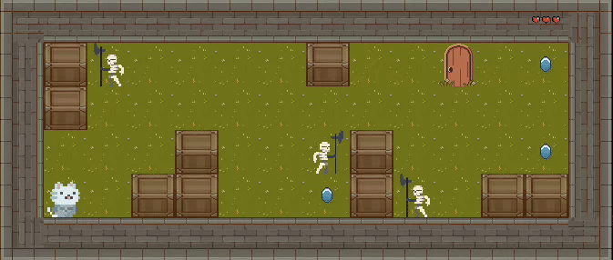
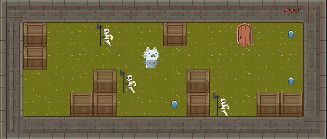
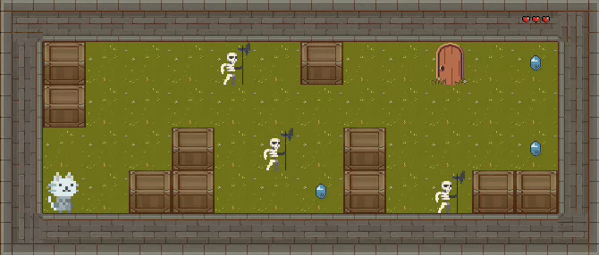

# SO_LONG

So_long is a project from the 42 Paris Common Core. It's a small 2D game written in C using the MiniLibX library, designed to introduce low-level graphics programming: opening a window, drawing sprites, handling keyboard input and running a game loop.

## Table of Contents

1. [Description](#description)
2. [Demo](#demo)
3. [Installation](#installation)
4. [Usage](#usage)
5. [Controls](#controls)
6. [Map format](#map-format)
7. [Challenges](#challenges)
8. [Credits](#credits)
9. [License](#license)

## Description

You play a knight cat who must collect every gem on the map, then reach the exit door. On some maps, skeletons wander around and you only have three lives.

As a 42 project, it follows the school's strict coding rules (the Norm): limited function length, restricted standard library usage, and a focus on clean, maintainable code.

### Features

- Animated sprites (player, gems, skeletons)
- Wandering skeleton enemies on some maps
- Three lives system
- Exit door that opens once all gems are collected
- Map validation before the game starts
- Random map support
- Win and death screens

## Demo

<p align="center">
  
</p>
<p align="center">
  
  
</p>

## Installation

The game needs the MiniLibX library. The Makefile automatically clones it when you run `make`, but this may vary depending on your OS. Feel free to change the repo link in the Makefile to match the MiniLibX version that suits your system.

On Ubuntu, you will also need the X11 development packages:

```
sudo apt install xorg libxext-dev libbsd-dev
```

### Supported OS

- **Ubuntu**: Tested and working
- **macOS**: Untested (may have compatibility issues)
- **Fedora**: Not compatible (due to MiniLibX function incompatibilities)

## Usage

1. Build the project:

```
make
```

2. Run the game with a map:

```
./so_long <map/random_map>
```

## Controls

| Key | Action |
|-----|--------|
| W/A/S/D (or Z/Q/S/D) or Arrow keys | Move |
| ESC | Quit |

## Map format

Maps are text files with the `.ber` extension. Each character describes one tile:

| Character | Meaning |
|-----------|---------|
| `1` | Wall |
| `0` | Empty floor |
| `P` | Player start (exactly one) |
| `E` | Exit door (exactly one) |
| `C` | Gem (at least one) |

A valid map must be rectangular, surrounded by walls, and the exit and all gems must be reachable from the player's start position. Invalid maps are rejected with an error message.

## Challenges

The main difficulties were learning how MiniLibX works (window, images, events), building a clean game loop with keyboard handling, animating sprites, making enemies move around, and validating that a map can actually be completed.

## Credits

All graphical assets come from independent artists on [itch.io](https://itch.io/). Huge thanks to them for sharing their work. Please check each pack's page for its license before reusing any asset.

| Asset | Pack | Author |
|-------|------|--------|
| Knight cat (player) | [Cute Legends: Cat Heroes](https://9e0.itch.io/cute-legends-cat-heroes) | [9e0](https://9e0.itch.io/) |
| Gems and coins (collectibles) | [Gems & Coins Free](https://laredgames.itch.io/gems-coins-free) | [LaredGames](https://laredgames.itch.io/) |
| Skeletons (enemies) | [Skeleton Pack](https://jesse-m.itch.io/skeleton-pack) | [Jesse M](https://jesse-m.itch.io/) |
| Brick and grass floor | [Pixel Art Top Down - Basic](https://cainos.itch.io/pixel-art-top-down-basic) | [Cainos](https://cainos.itch.io/) |
| Doors (exit) | [Peasants House](https://manjarcraft.itch.io/peasants-house) | [ManjarCraft](https://manjarcraft.itch.io/) |

## License

The game assets belong to their respective authors and are subject to the licenses listed on their itch.io pages (see [Credits](#credits)). MiniLibX is provided by 42 and distributed under its own license; see its repository for details.
